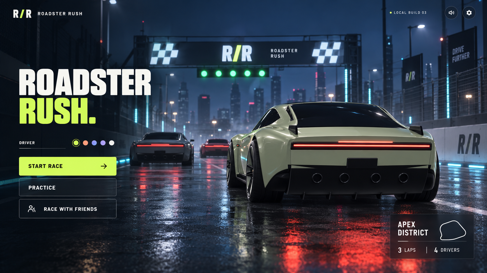

  <strong>R / R &nbsp; ROADSTER RUSH</strong> 
  THE DRIVER’S HANDBOOK &nbsp; / &nbsp; v0.5.0

Neon City · Cover artwork from early visual development. This handbook describes v0.5.0.

# Beyond grip.

**A Roadster-inspired arcade racer. Built for the corner, the jump and the last-lap comeback.**

Take a custom electric sports car onto neon streets and coastal straights. Collect your boost, choose your moment to attack, and turn a clean landing into your next advantage. Roadster Rush brings short, competitive races to your desktop browser.

  <a href="https://roadsterrush.xyz/"><strong>PLAY ROADSTER RUSH ↗</strong></a>
  &nbsp; · &nbsp;
  <a href="docs/guide/first-race.md">Your first race →</a>
  &nbsp; · &nbsp;
  <a href="docs/guide/controls.md">Controls reference →</a>

| **02** circuits               | **03** laps             | **04** drivers               | **v0.5.0**            |
| :---------------------------- | :---------------------- | :--------------------------- | :-------------------- |
| City nights & coastal sunsets | Every checkpoint counts | Solo rivals or private rooms | In active development |

> **Release status**
>
> v0.5.0 is an early playable release. **More builds and updates are on the way**, with continued work on driving feel, visual detail, performance and the multiplayer experience. [Follow the release notes →](docs/releases/v0.5.0.md)

## The idea behind the drive

The new **[Tesla Roadster](https://www.tesla.com/roadster)** is the inspiration: its low silhouette, electric performance and futuristic character. Roadster Rush translates that design language into a custom 3D car and an arcade racing experience with its own rules.

In the game, short thruster jumps let you clear obstacles. A second tap in the air triggers a 360 barrel roll. On the ground, drifting, collected boost and tactical power-ups give you several ways to fight for position.

The car’s design inspires the experience; the stunts and power-ups are the game’s creative interpretation. The focus is on learning a circuit, taking a risk at the right moment and earning a better lap.

## Find your line

### 01 / Own the corners

Brake for the turn, hold **X** to bring the rear around, then release it to regain grip. Point the car down the next straight before spending a boost. A controlled exit can matter more than a dramatic entry.

### 02 / Clear the obstacles

Tap **Space** to jump. Release it, then tap again in the air to roll through 360 degrees. Keep steering while airborne and aim for a clean landing. Thruster jumps are short; there is no sustained flight.

### 03 / Make the comeback

Pick up blue canisters for a **10-second boost**. Collect purple mystery boxes for a **Shield**, **Shockwave** or **EMP Trap**. Save a defence for the next attack, or leave a trap for the driver following your line.

**[Read the driving guide →](docs/guide/driving.md)** &nbsp; · &nbsp; **[Learn the power-ups →](docs/guide/power-ups.md)**

## Choose your race

| Mode                  | The experience                                                                 | Best place to start                                             |
| :-------------------- | :----------------------------------------------------------------------------- | :-------------------------------------------------------------- |
| **Start Race**        | Three laps against three AI rivals who collect and use items.                  | Learn to defend a position and time an overtake.                |
| **Practice**          | A solo three-lap session on your selected circuit.                             | Find braking points, practise drifting and land your first 360. |
| **Race with Friends** | A private room for two to four drivers, with a shared countdown and rematches. | Bring a group, share the room code and settle it on track.      |

Private online rooms need a connected race server. Solo racing and practice run independently in the browser. [How private rooms work →](docs/guide/multiplayer.md)

## Two places to chase a better lap

### Neon City

**01 · NIGHT CIRCUIT · APPROX. 1.01 KM**

Cyan lights trace the course beneath illuminated towers. Wet-road reflections, fencing and a city skyline frame a compact circuit with two jump obstacles. Learn the next corner before committing your boost.

### Starport Circuit

**02 · COASTAL SPACEPORT · APPROX. 1.30 KM**

Race past a solar-roof factory, charging plaza, assembly hangar and launch pads before sweeping along the coast. This fictional Tesla / SpaceX-inspired campus trades the city’s night lighting for warm sunset colours and dry tarmac.

Both circuits have **three laps, 12 ordered checkpoints, eight boost pickups and 18 mystery boxes**. [Explore the circuits →](docs/guide/circuits.md)

## Know these keys before the lights go out

| Drive                 | Jump & roll                                    | Drift                 | Boost         | Power-up  |
| :-------------------- | :--------------------------------------------- | :-------------------- | :------------ | :-------- |
| **W A S D** or arrows | **Space**, release, **Space** again in the air | Hold **X + steering** | Tap **Shift** | Tap **E** |

**R** reverses · **F** recovers the car with a three-second penalty · **C** changes camera · **M** toggles motor audio · **Esc** opens the race menu.

Standard controllers are supported. [Open the complete keyboard and controller reference →](docs/guide/controls.md)

## The driver’s handbook

Start with a first race, then explore the mechanics at your own pace. Each chapter includes the details you need at the wheel and a link to the next guide.

| Start here                                                                                                    | Learn the race                                                                                                 |
| :------------------------------------------------------------------------------------------------------------ | :------------------------------------------------------------------------------------------------------------- |
| **[01 · Your first race](docs/guide/first-race.md)** Set your name, choose your paint and learn the HUD.   | **[02 · Controls](docs/guide/controls.md)** Every keyboard input and controller mapping.                    |
| **[03 · Driving & stunts](docs/guide/driving.md)** Checkpoints, drifting, air control and recovery.        | **[04 · Boost & power-ups](docs/guide/power-ups.md)** Inventory, timing, item effects and counterplay.      |
| **[05 · The circuits](docs/guide/circuits.md)** Neon City, Starport and the race format.                   | **[06 · Race with friends](docs/guide/multiplayer.md)** Room codes, readiness, host controls and rematches. |
| **[07 · v0.5.0 & what’s next](docs/releases/v0.5.0.md)** What’s playable and where development is heading. | **[08 · Developer guide](docs/development.md)** Local setup, builds, race-server hosting and verification.  |

---

**The next build starts with a better lap.**

Roadster Rush is growing. More builds and updates are on the way, and hands-on feedback will help shape the experience. When sharing a problem, include your circuit, game mode, browser and what happened just before it.

**[Take your place on the grid ↗](https://roadsterrush.xyz/)**

---

**Next chapter → [Your first race](docs/guide/first-race.md)**
